# work-pixelclock – Pixel Panel für Windows

Ein Windows-Programm (`PixelPanel.exe`), das ein **iPixel-Color-LED-Panel per Bluetooth** steuert
und die Handy-App „iPixels“ komplett ersetzt. Neben Text, Emojis, Bildern und Uhren zeigt es
deinen **Microsoft-Teams-Status als Statuslicht** und deine **Claude-Nutzung** (Sitzung und Woche)
direkt auf dem Panel an.

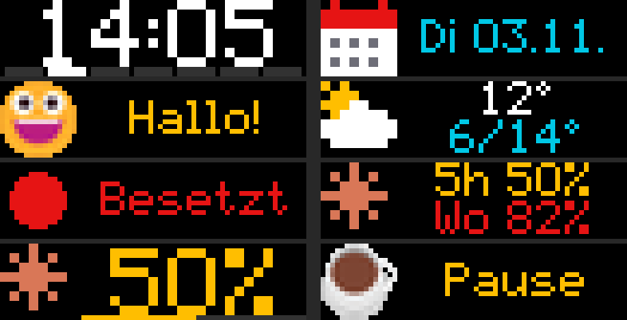

Getestet mit dem „LED flexible fun screen“ von Action (Briloner LED-Zeichentafel, Artikel 3226274):
64 × 16 RGB-LEDs, Strom über USB, Bluetooth-Name `LED_BLE_…`. Andere iPixel-Color-Panels
(32 × 16 bis 448 × 32) sprechen dasselbe Protokoll; die Größe liest das Programm aus dem Panel.

---

## Inhalt

- [Funktionen](#funktionen)
- [Schnellstart](#schnellstart)
- [Bedienung](#bedienung)
- [Teams-Statuslicht](#teams-statuslicht)
- [Claude-Nutzung](#claude-nutzung)
- [Kalender (nächstes Meeting)](#kalender-nächstes-meeting)
- [Wetter](#wetter)
- [Einstellungen und Dateien](#einstellungen-und-dateien)
- [Fehlerbehebung](#fehlerbehebung)
- [Entwicklung](#entwicklung)
- [Wie es funktioniert](#wie-es-funktioniert)
- [Herkunft und Danksagung](#herkunft-und-danksagung)

---

## Funktionen

| Bereich | Was geht |
|---|---|
| **Sofort anzeigen** | Text mit Emoji oder Icon, eigene Farbe, Hintergrund-Effekt, für X Sekunden oder dauerhaft; Bild oder animiertes GIF; die 9 eingebauten Uhr-Designs des Panels |
| **Seiten-Rotation** | Beliebig viele Seiten, die nacheinander durchlaufen: Uhr, Datum, Text/Emoji, Bild/GIF, Wetter, Teams-Status, Claude-Nutzung – jede mit eigener Anzeigedauer, per Haken an/aus, sortierbar |
| **Teams-Status** | Farbige Statusleiste am Rand jeder Seite; bei „Beschäftigt“, „Im Call“, „Nicht stören“ … leuchtet das ganze Panel in der Statusfarbe – automatisch, ohne Anmeldung |
| **Claude-Nutzung** | Prozent der 5-Stunden-Sitzung und des Wochenlimits deines Claude-Abos, farbig (grün/gelb/rot) |
| **Kalender** | Nächstes Meeting aus Outlook (ohne Anmeldung), einem Kalender-Link oder Microsoft 365, Countdown-Erinnerung kurz vor Beginn |
| **Emojis** | Echte Farb-Emojis (Windows-Emoji-Schrift) in 16 × 16 Pixel, ~50 eingebaute Pixel-Icons, tausende LaMetric-Icons (`lm:<id>`) oder eigene Bilddateien |
| **Effekte** | Regenbogen-Text, Matrix, Funkeln, Feuer, Plasma, Schnee, Regen, Pulsieren |
| **Übergänge** | Seitenwechsel springen, schieben, einschießen, überblenden, wischen, auflösen – oder mit **Nyan Cat** |
| **Panel** | An/aus, Helligkeit, Nachtmodus (zeitgesteuert dunkler), Ausrichtung inkl. hochkant |
| **Programm** | Läuft im Hintergrund (Symbol in der Taskleiste), Start mit Windows, verbindet sich automatisch neu |

<p>
  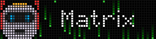
  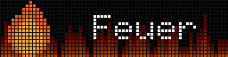
  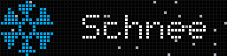
</p>

> **USB ist nur Strom.** Das Panel meldet sich am PC nicht als USB-Gerät an – gesteuert wird
> ausschließlich über **Bluetooth Low Energy**. Der PC braucht also Bluetooth (eingebaut oder Stick).

---

## Schnellstart

1. **Panel einstecken** (USB-Strom) und einschalten.
2. **Handy-App schließen** bzw. Bluetooth am Handy aus – das Panel nimmt nur *eine* Verbindung an.
3. `PixelPanel.exe` starten (siehe [Bauen](#exe-bauen), falls du noch keine hast).
4. Beim ersten Start sucht das Programm automatisch nach Panels. Wird genau eins gefunden, verbindet
   es sich sofort; sonst das gewünschte Panel oben auswählen und **Verbinden** klicken.
5. Fertig – die Rotation startet mit Uhr und Claude-Nutzung; das Teams-Statuslicht ist aktiv.

Das Panel muss **nicht** in den Windows-Bluetooth-Einstellungen gekoppelt werden.

---

## Bedienung

Links die Navigation (**Anzeigen**, **Seiten**, **Verbindungen**, **Einstellungen**) und darunter
der Verbindungsstatus. Oben steht immer die **Live-Vorschau** – sie sieht aus wie das Panel selbst
(runde LEDs, auch Animationen) – mit **Nächste Seite**, **Helligkeit** und **An/Aus**.

### Anzeigen

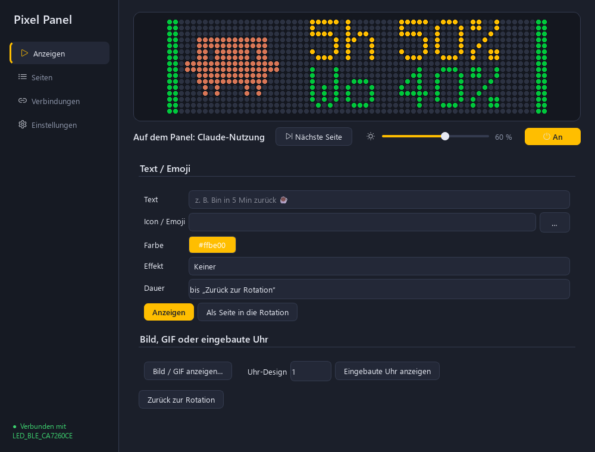

- **Text** eintippen, **Icon / Emoji** wählen (Liste aufklappen oder Emoji direkt einfügen),
  Farbe und Effekt wählen, **Anzeigen** (oder Enter).
- Ein Emoji *im Text* wird automatisch als Icon links angezeigt, z. B. `Bin gleich zurück ☕`.
- Langer Text läuft als Laufschrift.
- **Dauer** `0` = bleibt stehen, bis du **Zurück zur Rotation** klickst; sonst z. B. `60 s`.
- **Als Seite in die Rotation** übernimmt den Text dauerhaft.
- **Bild / GIF anzeigen…** – wird auf die Panelgröße verkleinert, GIFs laufen animiert.
- **Eingebaute Uhr anzeigen** – eines der 9 Uhr-Designs, die das Panel selbst kann.

### Seiten (Rotation)

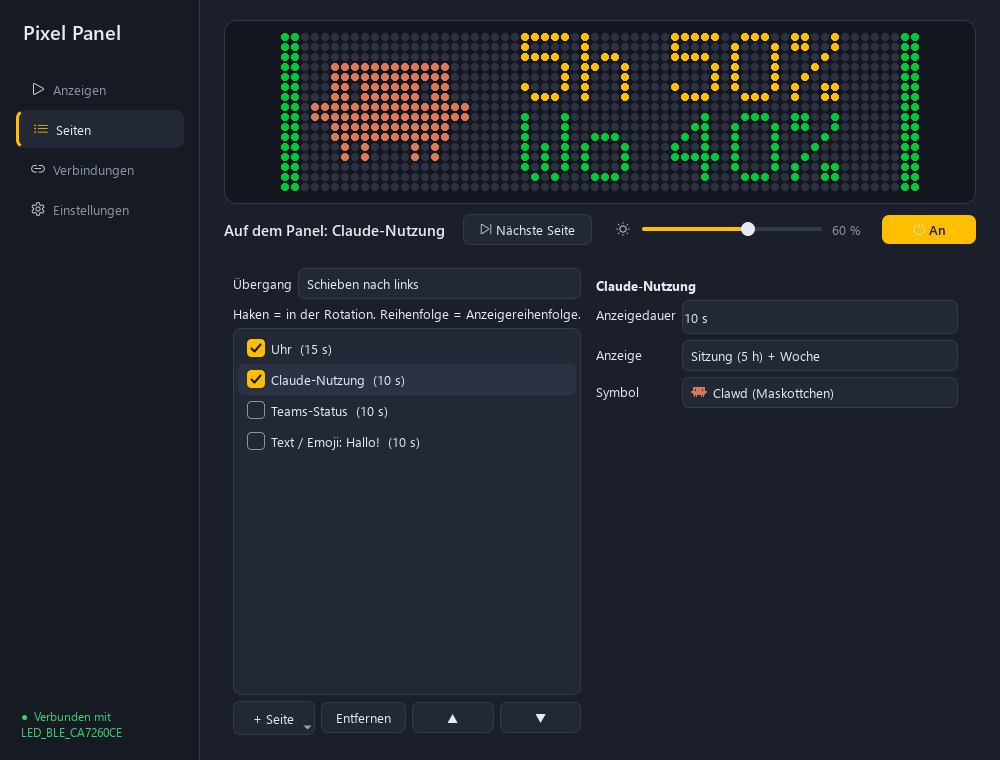

Links die Liste der Seiten: **Haken** = läuft in der Rotation mit, Reihenfolge per **▲ / ▼**,
neue Seite über **+ Seite**. Rechts die Einstellungen der gewählten Seite:

| Seite | Einstellungen |
|---|---|
| **Uhr** | Farbe, Effekt, Sekunden, Wochentag-Leiste |
| **Uhr (eingebaut im Panel)** | Design 0–8, Datum an/aus – läuft im Panel selbst |
| **Datum** | Farbe, Icon, Effekt |
| **Text / Emoji** | Text, Icon/Emoji, Farbe, Effekt |
| **Bild / GIF** | Datei |
| **Wetter** | Farbe, Effekt (Ort unter *Einstellungen*) |
| **Teams-Status** | farbiger Punkt + Status |
| **Claude-Nutzung** | Sitzung + Woche, nur Sitzung oder nur Woche (mit Balken); Symbol: Claude-Logo oder **Clawd** |
| **Nächstes Meeting** | Uhrzeit und Titel des nächsten Termins (Quelle unter *Verbindungen*) |

Laufschrift wird immer mindestens einmal komplett gezeigt, auch wenn die Anzeigedauer kürzer ist.

**Übergänge:** Oben im Tab wählst du, wie die nächste Seite aufs Panel kommt – *Sofort
(springen)*, *Schieben nach links / oben*, *Einschießen*, *Überblenden*, *Wischen*, *Auflösen*,
**Nyan Cat** oder *Zufällig*. Bei Nyan Cat fliegt die Katze über das Panel, zieht den Regenbogen
über die alte Seite, der Regenbogen blendet aus und darunter liegt die neue Seite. Übergänge
gelten für jeden Seitenwechsel (auch Statuslicht und Termin-Erinnerung); die Anzeigedauer einer
Seite zählt erst, wenn sie vollständig da ist.

<p>
  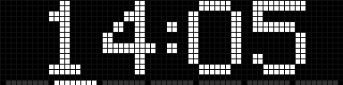
  
  
</p>

**Icons:** Feld *Icon / Emoji* akzeptiert

- ein Emoji, z. B. `🚀`
- einen eingebauten Namen, z. B. `heart`, `house`, `coffee`, `bell`, `car`, `music`, `star` …
- ein LaMetric-Icon: `lm:2867` (Nummer von [developer.lametric.com/icons](https://developer.lametric.com/icons))
- `claude` (Claude-Logo) oder `clawd` (Clawd, das Maskottchen von Claude Code)
- eine Bilddatei (Knopf **…**)

### Verbindungen

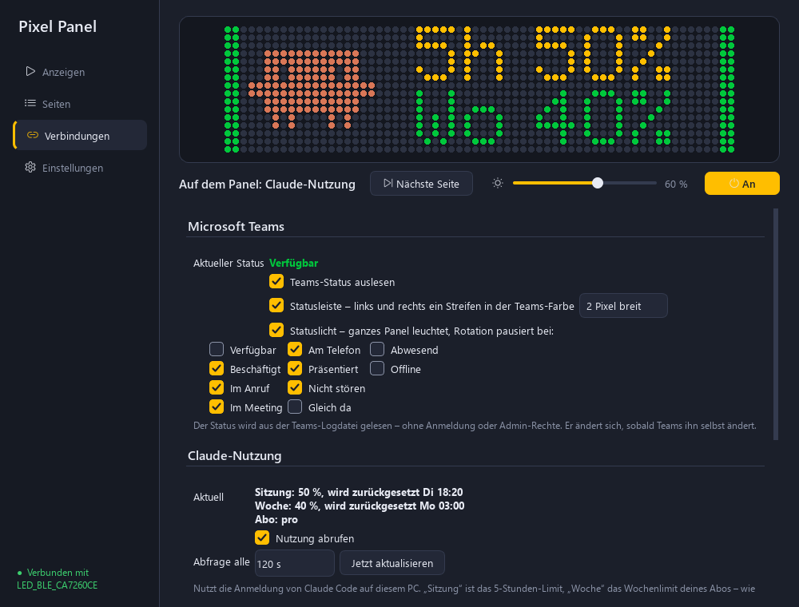

Alles, was Daten von außen holt: **Microsoft Teams**, **Claude-Nutzung** und **Kalender** – weitere
Dienste kommen hier dazu.

### Einstellungen

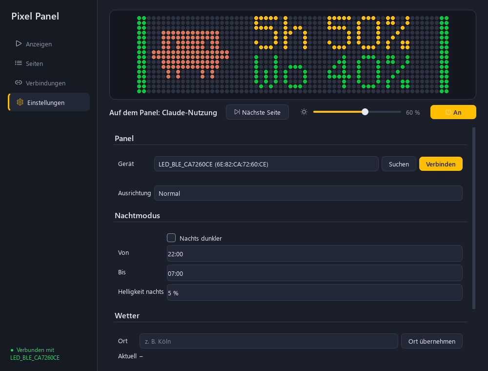

Panel (Gerät suchen/verbinden, Ausrichtung), Nachtmodus (Zeitraum + Helligkeit), Wetter-Ort,
**Mit Windows starten**, **Minimiert starten**.

### Taskleisten-Symbol

Das **X** am Fenster schließt nur das Fenster – das Panel wird weiter gesteuert. Über das Symbol
in der Taskleiste (Rechtsklick): Öffnen, Nächste Seite, Zurück zur Rotation, Panel an/aus,
Teams-Statuslicht an/aus, **Beenden**.

---

## Teams-Statuslicht

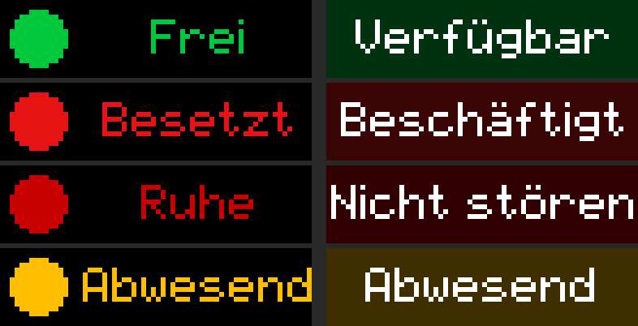

*Links: Teams-Seite in der Rotation. Rechts: Statuslicht (ganzes Panel leuchtet).*

- Der Status wird aus der **Logdatei des neuen Teams-Clients** gelesen
  (`%LOCALAPPDATA%\Packages\MSTeams_8wekyb3d8bbwe\LocalCache\Microsoft\MSTeams\Logs\MSTeams_*.log`,
  Zeilen `UserPresenceAction … availability: Busy`). Keine Anmeldung, keine Azure-App, keine
  Admin-Rechte; geprüft wird alle 2 Sekunden.
- **Statusleiste:** Solange die Rotation läuft, hat jede Seite links und rechts einen Streifen
  in der Teams-Farbe – der Status ist also immer sichtbar, ohne die Rotation anzuhalten. Breite
  **1, 2 oder 3 Pixel** einstellbar (Standard 2), abschaltbar unter *Verbindungen*. Die Seite
  wird dafür schmaler gezeichnet und hält 1 Pixel Abstand – die Streifen überdecken nichts und
  Icons stoßen nicht an.

  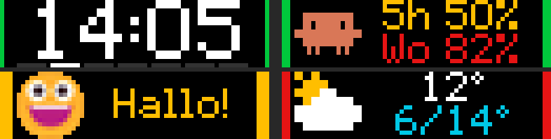

- **Statuslicht:** Unter *Verbindungen* legst du fest, **bei welchen Status** das ganze Panel
  leuchtet und die Rotation pausiert (Standard: Beschäftigt, Im Anruf, Im Meeting, Am Telefon,
  Präsentiert, Nicht stören). **Nur Status anhaken, bei denen die Rotation wirklich anhalten
  soll** – wer „Verfügbar“ anhakt, hat dauerhaft Statuslicht und keine Rotation mehr.
- Priorität: **Sofort anzeigen** > **Statuslicht** > **Rotation**. Ist keine Seite angehakt,
  zeigt das Panel die Uhr.
- Grenzen: Funktioniert nur mit dem neuen Teams („Teams 2.0“) auf demselben PC. Während eines Anrufs
  schreibt Teams meist nur „Beschäftigt“ ins Log. Da es keine offizielle Schnittstelle ist, kann ein
  Teams-Update das Format ändern.

---

## Claude-Nutzung

- Zeigt die Auslastung deines **Claude-Abos**: **Sitzung** (5-Stunden-Limit) und **Woche** –
  dieselben Werte wie unter claude.ai › Einstellungen › Nutzung.
- Voraussetzung: **Claude Code ist auf diesem PC angemeldet** (`claude` → `/login`). Das Programm
  liest das Token aus `%USERPROFILE%\.claude\.credentials.json` und fragt
  `api.anthropic.com/api/oauth/usage` ab (Standard alle 120 s). Das Token wird nur gelesen, nie
  verändert oder weitergegeben.
- Ist die Anmeldung abgelaufen, steht ein Hinweis auf dem Panel – einmal Claude Code öffnen genügt.
- Farben: grün < 50 %, gelb < 80 %, rot ab 80 %.
- Symbol wählbar: Claude-Logo oder **Clawd**, das Maskottchen aus Claude Code.

  

---

## Kalender (nächstes Meeting)

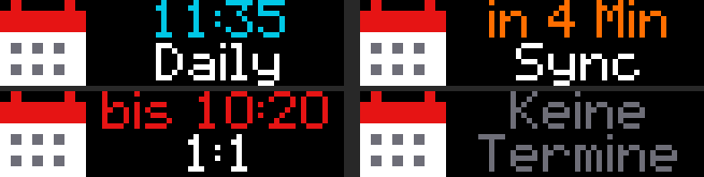

*Nächstes Meeting · Erinnerung kurz vorher · laufendes Meeting · keine Termine*

- Seite **„Nächstes Meeting“**: Uhrzeit (bzw. Wochentag + Uhrzeit, wenn nicht heute) und Titel.
  Läuft gerade ein Meeting: „bis 11:00“.
- **Erinnerung:** X Minuten vor Beginn (Standard 5) erscheint ein Countdown „in 4 Min“ – mit
  Vorrang vor Statuslicht und Rotation.
- Nicht gezählt werden abgesagte, abgelehnte, ganztägige und als „frei“ eingetragene Termine.
- Abruf alle 5 Minuten. Unter *Verbindungen › Kalender* wählst du die **Quelle**:

| Quelle | Anmeldung | Voraussetzung |
|---|---|---|
| **Outlook auf diesem PC** (Standard) | keine | Klassisches Outlook ist installiert und eingerichtet (auch wenn man sonst das neue Outlook nutzt). Es wird bei Bedarf unsichtbar gestartet und nur gelesen. |
| **Kalender-Link (ICS)** | keine | In Outlook im Web › Einstellungen › Kalender › Freigegebene Kalender › *Kalender veröffentlichen* einen ICS-Link erzeugen (z. B. „Kann Titel und Orte anzeigen“). Wer den Link kennt, sieht die Termine; manche Firmen schalten das ab. |
| **Microsoft 365 (Anmeldung)** | einmalig im Browser | App-Registrierung, siehe unten |

### Microsoft 365: App-Registrierung (einmalig, ggf. durch die IT)

Microsoft lässt Programme nur mit einer registrierten App-ID anmelden – ein reiner „Anmelden“-Knopf
ohne Registrierung ist nicht möglich. Darf man in der Firma keine Apps registrieren, die IT mit
genau diesen Angaben bitten – oder eine der Quellen ohne Anmeldung nutzen:

1. [Entra Admin Center](https://entra.microsoft.com) › **Anwendungen › App-Registrierungen ›
   Neue Registrierung**
   - Name: `Pixel Panel`
   - Kontotypen: **Nur Konten in diesem Organisationsverzeichnis**
   - Umleitungs-URI: Plattform **Öffentlicher Client/nativ (mobil und Desktop)**, URI
     `http://localhost`
2. **Authentifizierung** › *Öffentliche Clientflows zulassen*: **Ja**
3. **API-Berechtigungen** › Berechtigung hinzufügen › Microsoft Graph › **Delegierte
   Berechtigungen** › `Calendars.Read` (`User.Read` ist schon da). Wenn Benutzer in eurem
   Mandanten nicht selbst zustimmen dürfen: **Administratorzustimmung erteilen**.
4. Auf der Übersichtsseite **Anwendungs-ID (Client)** und **Verzeichnis-ID (Mandant)** kopieren.

In Pixel Panel › *Verbindungen › Kalender*: Quelle **Microsoft 365** wählen, beide IDs eintragen,
*Nächstes Meeting abrufen* anhaken, **Anmelden** – der Browser öffnet die normale Microsoft-Anmeldung. Danach bleibt man angemeldet
(Token verschlüsselt mit Windows-DPAPI in `%APPDATA%\PixelPanel\m365_token.bin`; **Abmelden**
löscht es). Die App kann nur lesen, nichts ändern oder senden.

---

## Wetter

Unter *Einstellungen › Wetter* einen Ort eingeben und **Ort übernehmen**. Daten von
[Open-Meteo](https://open-meteo.com) (kostenlos, kein API-Schlüssel), Aktualisierung alle 15 Minuten.
Die Wetter-Seite zeigt Symbol, aktuelle Temperatur und Tiefst-/Höchstwert des Tages.

---

## Einstellungen und Dateien

| Was | Wo |
|---|---|
| Einstellungen | `%APPDATA%\PixelPanel\config.json` (wird beim Ändern automatisch gespeichert) |
| Log | `%APPDATA%\PixelPanel\pixelpanel.log` |
| LaMetric-Icon-Cache | `%APPDATA%\PixelPanel\icons\` |
| Autostart | Registry `HKCU\Software\Microsoft\Windows\CurrentVersion\Run\PixelPanel` |

Zum Zurücksetzen Programm beenden und `config.json` löschen.

---

## Fehlerbehebung

| Problem | Lösung |
|---|---|
| **Kein Panel gefunden** | Panel an? Handy-App geschlossen / Handy-Bluetooth aus? (Ein verbundenes Panel ist für andere unsichtbar.) Bluetooth am PC an? Näher ran. |
| **„Panel nicht erreichbar – neuer Versuch läuft“** | Programm versucht es alle 15 s erneut. Panel kurz vom Strom trennen hilft meistens. |
| **Handy-App verbindet nicht mehr** | Pixel Panel über das Taskleisten-Symbol **beenden** – dann ist das Panel wieder frei. |
| **Rotation läuft nicht / Panel hängt auf einem Teams-Status** | Unter *Verbindungen* beim Statuslicht nur „Beschäftigt“-artige Status anhaken (nicht „Verfügbar“), und unter *Seiten* mindestens zwei Seiten anhaken. |
| **Teams-Status bleibt „noch kein Status“** | Nur der neue Teams-Client wird unterstützt. Status einmal in Teams ändern, dann taucht er im Log auf. |
| **Claude: „Nicht in Claude Code angemeldet“ / „Anmeldung abgelaufen“** | Claude Code starten und ggf. `/login`. |
| **„Pixel Panel läuft bereits“** | Es läuft schon eine Instanz – Symbol in der Taskleiste (ggf. unter ^). |
| Sonstiges | `%APPDATA%\PixelPanel\pixelpanel.log` ansehen. |

---

## Entwicklung

Voraussetzungen: Windows 10/11 mit Bluetooth LE, [uv](https://docs.astral.sh/uv/) (oder Python 3.13 + pip).

```powershell
git clone https://github.com/Nipo-98/work-pixelclock.git
cd work-pixelclock
uv venv --python 3.13 .venv
uv pip install --python .venv\Scripts\python.exe -r requirements.txt

.venv\Scripts\python.exe -m pixelpanel      # starten
.venv\Scripts\python.exe -m pytest tests    # Tests
```

### .exe bauen

```powershell
powershell -ExecutionPolicy Bypass -File build.ps1
# -> dist\PixelPanel.exe  (eine Datei, ~50 MB, keine Installation nötig)
```

`build.ps1` legt bei Bedarf die virtuelle Umgebung an, erzeugt das Programm-Icon und baut mit
PyInstaller (`--onefile --windowed`).

### Projektstruktur

```
pixelpanel/
  __main__.py     Start, Logging
  gui.py          Fenster, Tabs, Vorschau, Taskleisten-Symbol (PySide6)
  engine.py       Hintergrund-Thread: Verbindung, Rotation, Prioritäten, Senden
  ble.py          Bluetooth-LE-Verbindung zum Panel (bleak), Upload mit ACKs
  pages.py        Seite + Live-Daten -> Bild/GIF (Emojis, Icons, Teams, Claude, Wetter …)
  transitions.py  Übergänge zwischen Seiten (inkl. Nyan Cat)
  sources.py      Teams-Log, Claude-Nutzung, Wetter (Open-Meteo)
  m365.py         Microsoft-365-Kalender (MSAL-Anmeldung, Graph calendarView)
  calendars.py    Kalender ohne Anmeldung: klassisches Outlook (COM) und ICS-Link
  theme.py        Farben und Stylesheet der Oberfläche
  config.py       Einstellungen (JSON in %APPDATA%\PixelPanel)
  autostart.py    Start mit Windows (Registry, ohne Admin)
  core/           Protokoll, Pixelschrift, Icons, Effekte, Zeichnen – aus ha-pixelclock
tests/            pytest
build.ps1         baut dist\PixelPanel.exe
run.py            Einstiegspunkt für PyInstaller
```

---

## Wie es funktioniert

- **Protokoll:** Das Panel bietet den BLE-Dienst `0x00FA`. Befehle gehen an `FA02`, Antworten
  kommen als Benachrichtigung auf `FA03`. Jeder Befehl ist `<Länge u16 LE><cmd><typ><daten>`.
  Direkt unterstützt: Strom, Helligkeit, Uhrzeit, eingebaute Uhren, Ausrichtung – und das Hochladen
  eines PNG/GIF in 12-KB-Fenstern, die das Panel einzeln bestätigt.
- **Alles andere ist ein Bild:** Text, Laufschrift, Emojis, Effekte, Teams- und Claude-Anzeige werden
  auf dem PC mit Pillow pixelgenau gezeichnet und als PNG (still) oder GIF (animiert) gesendet. Ein
  animiertes GIF von ~20 KB ist in unter einer Sekunde übertragen; die Animation läuft danach im Panel
  selbst weiter.
- **Übergänge:** Beim Seitenwechsel wird erst ein kurzes GIF vom alten zum neuen Bild gesendet,
  dessen letztes Bild (die neue Seite) 5 s stehen bleibt; nach dem Abspielen folgt die eigentliche
  Seite. So springt das Panel nie zurück an den Anfang des Übergangs.
- **Nur bei Änderungen senden:** Jede Seite hat eine „Signatur“ (z. B. Uhrzeit auf die Minute,
  Teams-Status, Claude-Prozente). Nur wenn sie sich ändert, wird neu gesendet.
- **Verbindung:** bleibt dauerhaft offen; bei Abbruch wird alle 15 s neu verbunden. Die Panel-Uhr
  wird beim Verbinden und täglich gestellt.

---

## Herkunft und Danksagung

Protokoll, Pixelschrift, Icons, Effekte und Zeichenfunktionen (`pixelpanel/core/`) stammen – mit
Erlaubnis des Autors – aus
[dominguez-posh/ha-pixelclock](https://github.com/dominguez-posh/ha-pixelclock), einer
Home-Assistant-Integration für dieselben Panels. Dessen Protokoll basiert wiederum auf dem
Reverse Engineering in [pypixelcolor](https://github.com/lucagoc/pypixelcolor) (MIT).

Wetterdaten: [Open-Meteo](https://open-meteo.com) (CC BY 4.0). Icons optional von
[LaMetric](https://developer.lametric.com/icons). Emojis: Windows-Schrift „Segoe UI Emoji“
(wird zur Laufzeit vom System verwendet, nicht mitgeliefert).

Nicht offiziell mit Action, Briloner, iPixels, Microsoft oder Anthropic verbunden.
